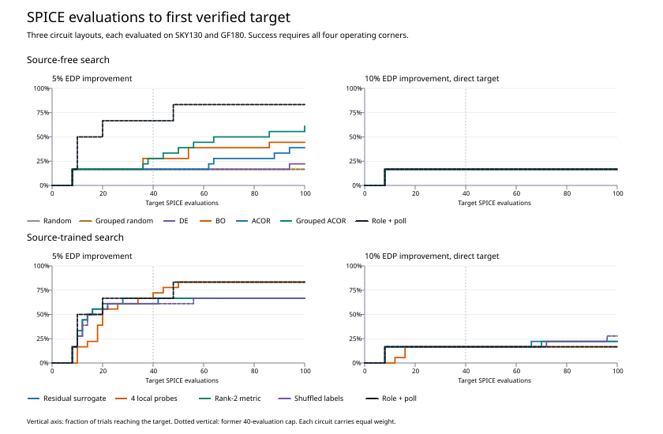

# 100 SPICE eval에서의 최초 FoM 도달과 회로 전이

5%는 기존 기준과 같은 공동 추적의 첫 0.95 도달이고, 10% 단독은 0.90 가능 후보만 확인한다. 각 표는 성공 수/시행 수와 실패 포함 제한 평균 SPICE 호출 수다. 독립적인 회로 형상은 세 가지이며 각각 두 PDK를 짝지었다. 형상 두 가지와 부하 조건은 이전 실험에서 사용했고, 3출력 비대칭 병렬 회로 한 가지는 이번에 추가했다. 각 조건의 확률적 탐색은 3 seed, 결정적 역할 직접 탐색은 조건당 1회다. 방법 간 승패는 이 회로들의 기술 통계다.

## 전체 탐색 비용

| 방법 | 5% ≤40회 | 5% ≤100회 | 10% 단독 ≤40회 | 10% 단독 ≤100회 | 10% 공동 ≤100회 |
|---|---|---|---|---|---|
| 역할 규칙 + 직접 탐색 | 4/6 · 21.33 | 5/6 · 32.67 | 1/6 · 34.67 | 1/6 · 84.67 | 1/6 · 84.67 |
| 잔차 SPICE surrogate, 웜업 4 | 13/18 · 25.44 | 15/18 · 36.22 | 3/18 · 35.78 | 3/18 · 85.78 | 3/18 · 86.11 |
| 잔차 SPICE surrogate, 웜업 0 | 12/18 · 22.11 | 12/18 · 42.11 | 3/18 · 34.67 | 4/18 · 82.78 | 3/18 · 84.67 |
| 방향 선호 rank-2 | 11/18 · 22.78 | 12/18 · 42.89 | 3/18 · 34.67 | 4/18 · 83.00 | 4/18 · 83.44 |
| 방향 라벨 셔플 | 11/18 · 23.22 | 12/18 · 44.11 | 3/18 · 34.67 | 5/18 · 82.89 | 3/18 · 84.67 |
| 역할 4좌표 ACOR | 5/18 · 34.33 | 11/18 · 66.56 | 3/18 · 34.67 | 3/18 · 84.67 | 3/18 · 84.67 |
| 제약 확률 BO | 5/18 · 34.22 | 8/18 · 71.67 | 3/18 · 34.67 | 3/18 · 84.67 | 3/18 · 84.67 |
| 전체 폭 ACOR | 3/18 · 34.67 | 7/18 · 79.56 | 3/18 · 34.67 | 3/18 · 84.67 | 3/18 · 84.67 |
| 차분 진화 DE | 3/18 · 34.67 | 4/18 · 84.33 | 3/18 · 34.67 | 3/18 · 84.67 | 3/18 · 84.67 |
| 전체 폭 랜덤 | 3/18 · 34.67 | 3/18 · 84.67 | 3/18 · 34.67 | 3/18 · 84.67 | 3/18 · 84.67 |
| 역할 4좌표 랜덤 | 3/18 · 34.67 | 3/18 · 84.67 | 3/18 · 34.67 | 3/18 · 84.67 | 3/18 · 84.67 |

성공 여부는 동일한 소자 폭에서 개발·확인 코너의 에너지×최대 에지 지연과 모든 전기 제약을 실측하여 판정한다. 평균은 최초 도달까지의 호출 수와 미달 시 해당 상한으로 계산했다. 평균과 성공 수에는 100번째 호출에 성공한 경우가 서로 다르게 반영될 수 있다. 타깃의 기준 4회를 포함하고 워밍업과 확인도 유료다. 40회와 100회는 같은 실행에서 읽었다.

BO 획득함수를 5%에 맞춘 추가 대조군은 40회 7/18 · 29.67, 100회 12/18 · 58.22였다. 공동 BO의 획득함수 문턱은 10%다. 두 실험에서 후보 풀, 커널과 seed를 동일하게 유지했다.

0.25 ps 수치 검산까지 같은 예산 안에서 청구한 비교를 별도로 계산했다. 최초 적격 후보에서 정밀 기준 4회와 설계 4회를 지불한다. 정밀 검산이 탈락하면 후속 적격 설계마다 4회를 추가한다. [정밀 비용 포함 전체 표](runs/century/charged_precision.csv) · [역할 제안과 웜업을 조합한 후속 독립 테스트](PORTFOLIO_RESULTS_KO.md)

## 전이 조건별 결과

| 방법 | 기존 4조건 5% | 신규 2조건 5% | 기존 4조건 10% 단독 | 신규 2조건 10% 단독 |
|---|---|---|---|---|
| 역할 규칙 + 직접 탐색 | 3/4 · 44.50 | 2/2 · 9.00 | 0/4 · 100.00 | 1/2 · 54.00 |
| 잔차 SPICE surrogate, 웜업 4 | 9/12 · 44.00 | 6/6 · 20.67 | 0/12 · 100.00 | 3/6 · 57.33 |
| 잔차 SPICE surrogate, 웜업 0 | 6/12 · 57.67 | 6/6 · 11.00 | 1/12 · 97.17 | 3/6 · 54.00 |
| 방향 선호 rank-2 | 6/12 · 56.17 | 6/6 · 16.33 | 1/12 · 97.50 | 3/6 · 54.00 |
| 방향 라벨 셔플 | 6/12 · 56.67 | 6/6 · 19.00 | 2/12 · 97.33 | 3/6 · 54.00 |
| 역할 4좌표 ACOR | 6/12 · 77.50 | 5/6 · 44.67 | 0/12 · 100.00 | 3/6 · 54.00 |
| 제약 확률 BO | 5/12 · 80.50 | 3/6 · 54.00 | 0/12 · 100.00 | 3/6 · 54.00 |
| 전체 폭 ACOR | 4/12 · 92.33 | 3/6 · 54.00 | 0/12 · 100.00 | 3/6 · 54.00 |
| 차분 진화 DE | 1/12 · 99.50 | 3/6 · 54.00 | 0/12 · 100.00 | 3/6 · 54.00 |
| 전체 폭 랜덤 | 0/12 · 100.00 | 3/6 · 54.00 | 0/12 · 100.00 | 3/6 · 54.00 |
| 역할 4좌표 랜덤 | 0/12 · 100.00 | 3/6 · 54.00 | 0/12 · 100.00 | 3/6 · 54.00 |

### 5% 목표, 100회 상한

| 방법 | pair_new_sky | pair_new_gf | tree_new_sky | tree_new_gf | parallel100_sky | parallel100_gf |
|---|---|---|---|---|---|---|
| 역할 규칙 + 직접 탐색 | 1/1 · 48.00 | 1/1 · 10.00 | 0/1 · 100.00 | 1/1 · 20.00 | 1/1 · 10.00 | 1/1 · 8.00 |
| 잔차 SPICE surrogate, 웜업 4 | 1/3 · 72.67 | 3/3 · 17.33 | 2/3 · 59.33 | 3/3 · 26.67 | 3/3 · 28.67 | 3/3 · 12.67 |
| 잔차 SPICE surrogate, 웜업 0 | 0/3 · 100.00 | 3/3 · 11.33 | 0/3 · 100.00 | 3/3 · 19.33 | 3/3 · 14.00 | 3/3 · 8.00 |
| 방향 선호 rank-2 | 0/3 · 100.00 | 3/3 · 10.67 | 0/3 · 100.00 | 3/3 · 14.00 | 3/3 · 24.67 | 3/3 · 8.00 |
| 방향 라벨 셔플 | 0/3 · 100.00 | 3/3 · 14.00 | 0/3 · 100.00 | 3/3 · 12.67 | 3/3 · 30.00 | 3/3 · 8.00 |
| 역할 4좌표 ACOR | 0/3 · 100.00 | 3/3 · 52.00 | 0/3 · 100.00 | 3/3 · 58.00 | 2/3 · 81.33 | 3/3 · 8.00 |
| 제약 확률 BO | 0/3 · 100.00 | 3/3 · 42.00 | 0/3 · 100.00 | 2/3 · 80.00 | 0/3 · 100.00 | 3/3 · 8.00 |
| 전체 폭 ACOR | 0/3 · 100.00 | 2/3 · 83.33 | 0/3 · 100.00 | 2/3 · 86.00 | 0/3 · 100.00 | 3/3 · 8.00 |
| 차분 진화 DE | 0/3 · 100.00 | 1/3 · 98.00 | 0/3 · 100.00 | 0/3 · 100.00 | 0/3 · 100.00 | 3/3 · 8.00 |
| 전체 폭 랜덤 | 0/3 · 100.00 | 0/3 · 100.00 | 0/3 · 100.00 | 0/3 · 100.00 | 0/3 · 100.00 | 3/3 · 8.00 |
| 역할 4좌표 랜덤 | 0/3 · 100.00 | 0/3 · 100.00 | 0/3 · 100.00 | 0/3 · 100.00 | 0/3 · 100.00 | 3/3 · 8.00 |

### 10% 단독 목표, 100회 상한

| 방법 | pair_new_sky | pair_new_gf | tree_new_sky | tree_new_gf | parallel100_sky | parallel100_gf |
|---|---|---|---|---|---|---|
| 역할 규칙 + 직접 탐색 | 0/1 · 100.00 | 0/1 · 100.00 | 0/1 · 100.00 | 0/1 · 100.00 | 0/1 · 100.00 | 1/1 · 8.00 |
| 잔차 SPICE surrogate, 웜업 4 | 0/3 · 100.00 | 0/3 · 100.00 | 0/3 · 100.00 | 0/3 · 100.00 | 0/3 · 100.00 | 3/3 · 14.67 |
| 잔차 SPICE surrogate, 웜업 0 | 0/3 · 100.00 | 0/3 · 100.00 | 0/3 · 100.00 | 1/3 · 88.67 | 0/3 · 100.00 | 3/3 · 8.00 |
| 방향 선호 rank-2 | 0/3 · 100.00 | 0/3 · 100.00 | 0/3 · 100.00 | 1/3 · 90.00 | 0/3 · 100.00 | 3/3 · 8.00 |
| 방향 라벨 셔플 | 0/3 · 100.00 | 0/3 · 100.00 | 0/3 · 100.00 | 2/3 · 89.33 | 0/3 · 100.00 | 3/3 · 8.00 |
| 역할 4좌표 ACOR | 0/3 · 100.00 | 0/3 · 100.00 | 0/3 · 100.00 | 0/3 · 100.00 | 0/3 · 100.00 | 3/3 · 8.00 |
| 제약 확률 BO | 0/3 · 100.00 | 0/3 · 100.00 | 0/3 · 100.00 | 0/3 · 100.00 | 0/3 · 100.00 | 3/3 · 8.00 |
| 전체 폭 ACOR | 0/3 · 100.00 | 0/3 · 100.00 | 0/3 · 100.00 | 0/3 · 100.00 | 0/3 · 100.00 | 3/3 · 8.00 |
| 차분 진화 DE | 0/3 · 100.00 | 0/3 · 100.00 | 0/3 · 100.00 | 0/3 · 100.00 | 0/3 · 100.00 | 3/3 · 8.00 |
| 전체 폭 랜덤 | 0/3 · 100.00 | 0/3 · 100.00 | 0/3 · 100.00 | 0/3 · 100.00 | 0/3 · 100.00 | 3/3 · 8.00 |
| 역할 4좌표 랜덤 | 0/3 · 100.00 | 0/3 · 100.00 | 0/3 · 100.00 | 0/3 · 100.00 | 0/3 · 100.00 | 3/3 · 8.00 |

## 같은 회로와 seed의 대응 비교

| 대응 비교 A vs B | 5% A 승/무/패 | 5% A−B 비용 | 10% A 승/무/패 | 10% A−B 비용 |
|---|---|---|---|---|
| 방향 선호 rank-2 vs 잔차 SPICE surrogate, 웜업 0 | 3/13/2 | +0.78 | 0/17/1 | +0.22 |
| 방향 선호 rank-2 vs 방향 라벨 셔플 | 3/13/2 | -1.22 | 1/15/2 | +0.11 |
| 잔차 SPICE surrogate, 웜업 4 vs 잔차 SPICE surrogate, 웜업 0 | 4/4/10 | -5.89 | 0/14/4 | +3.00 |
| 전체 폭 ACOR vs 전체 폭 랜덤 | 4/14/0 | -5.11 | 0/18/0 | +0.00 |
| 역할 4좌표 ACOR vs 역할 4좌표 랜덤 | 7/11/0 | -18.11 | 0/18/0 | +0.00 |
| 역할 4좌표 ACOR vs 전체 폭 ACOR | 7/11/0 | -13.00 | 0/18/0 | +0.00 |
| 차분 진화 DE vs 전체 폭 랜덤 | 1/17/0 | -0.33 | 0/18/0 | +0.00 |

## 회로별 실측 가능성

| 조건 | 개발 후보 | 개발 EDP ≤.95 | 개발 제약도 통과 | 확인한 후보 | 4코너 5% | 4코너 10% | 최저 확인 EDP |
|---|---|---|---|---|---|---|---|
| pair_new_sky | 1550 | 97 | 7 | 7 | 4 | 0 | 0.94829 |
| pair_new_gf | 1434 | 733 | 533 | 288 | 277 | 0 | 0.90870 |
| tree_new_sky | 1549 | 179 | 77 | 59 | 7 | 0 | 0.94513 |
| tree_new_gf | 1365 | 772 | 558 | 375 | 221 | 4 | 0.89228 |
| parallel100_sky | 1497 | 606 | 367 | 211 | 153 | 0 | 0.91501 |
| parallel100_gf | 11 | 7 | 5 | 5 | 4 | 2 | 0.89016 |

두 프로토콜과 모든 방법의 고유 후보를 합쳤다. 개발 EDP, 네 코너 제약 및 가장 낮은 확인 EDP는 서로 다른 열이다. 후보가 확인되지 않았거나 통과하지 못한 경우, 측정 범위를 넘어선 최적값은 알 수 없다.

## 실제 SPICE 방향 선호로 학습한 metric

각 SKY130 소스 회로에서 3개 anchor와 anchor당 8개 방향을 사용했다. 방향은 로그 폭 공간에서 L2 길이 0.10이고 실제 폭 반올림 오차는 허용했다. 같은 anchor의 28쌍은 8번의 후보 측정을 공유한다. 실측에서 허용 제약을 충족한 방향을 먼저 선호하고 양의 로그 제약 위반 합, EDP 순으로 비교했다. 12개 방향 집합이 제공한 336개 비교를 독립적인 실험 횟수로 세지 않는다.

기본 대각 행렬 D, 역할 특징 Φ, 학습 행렬 B로 역 metric을 D^(-1/2) [I + Φ B Bᵀ Φᵀ] D^(-1/2)로 구성했다. 10×2 행렬 B는 측정 순위와 제안 방향 내적의 쌍대 로지스틱 손실로 학습했다. SPICE surrogate, 타깃 잔차 보정, 후보 수와 선탐색은 웜업 0과 같다. 표의 보류 조건은 한 소스 회로의 방향 라벨을 제외하고 B를 재학습한 결과다. 기반 SPICE surrogate는 기존 네 소스 회로의 324회 자료를 사용했다.

| 방향 모델 | seed | 전체 방향 자료 적합 후 정순위 | 보류 회로 기본 방향 | 보류 회로 학습 방향 |
|---|---|---|---|---|
| 방향 선호 rank-2 | 31 | 63.4% | 49.4% | 51.5% |
| 방향 선호 rank-2 | 32 | 65.2% | 50.3% | 48.5% |
| 방향 선호 rank-2 | 33 | 71.1% | 51.5% | 55.4% |
| 방향 라벨 셔플 | 31 | 53.6% | 49.4% | 54.8% |
| 방향 라벨 셔플 | 32 | 56.0% | 50.3% | 53.9% |
| 방향 라벨 셔플 | 33 | 65.8% | 51.5% | 60.4% |

소스에서 기본 방향과 rank-2 방향의 각도 중앙값은 54.1°였다. 선호 손실 gradient를 유한차분으로 검사한 최대 절대 오차는 2.00e-11다. 타깃에서는 역할 제안 뒤 두 번째 설계까지 진행된 15개 대응 시행 중 15개에서 rank-2가 실제로 다른 폭을 SPICE에 보냈다. 이 시점의 소자별 로그 폭 RMS 차이 중앙값은 0.0461였다.

## 비용 검산과 재현

공동 및 단독 목표를 합쳐 390개 프로토콜별 궤적을 원시값에서 재계산했다. 독립 실행으로 청구한 타깃 호출 수는 공동 15,752회, 10% 단독 15,672회, 목표를 맞춘 5% BO 1,048회다. 동일한 설계의 코너값을 재사용했으며 두 프로토콜을 합친 고유 타깃 코너 측정은 16,726개다. 실패 측정은 0개다. 기본 학습 비용은 소스 324회, 방향 선호에는 추가 후보 192회와 nominal 기준 재측정 8회를 썼다. 모델과 무관한 탐색은 소스 비용이 0이다.

0.25 ps로 최초 도달 설계 78개와 해당 기준 설계를 검산했다. 재검산 비용은 336회이며 이전 동일 정밀도 자료 76회를 포함한다. 최초 도달 기록 171건 중 재검산 미통과는 0건이다.

기본 ngspice 실행과 컴파일 모듈을 재사용하는 실행기를 동일한 6개 회로 × 4코너에서 비교해 에너지, 지연, slew, 레일 출력 측정값의 일치를 확인했다. 각 eval은 독립적인 ngspice 메모리·회로·동작점에서 수행한다.

기존 패키지의 ngspice 및 PDK 인자로 century_run.py search, century_run.py source, century_role.py search, century_strict.py search, century_bo_goal.py search, century_audit.py search 순서로 실행한다. python century_restore.py는 시뮬레이터 없이 압축 원자료에서 모든 최초 도달과 표를 재생한다.

[평가 규약](century_protocol.md) · [전체 수치](runs/century/summary.csv) · [원시 측정과 궤적](century_measurements.zip) · [검산](runs/century/audit.json)

[Socha & Dorigo, ACOR](https://doi.org/10.1016/j.ejor.2006.06.046) · [Storn & Price, DE](https://doi.org/10.1023/A:1008202821328)
