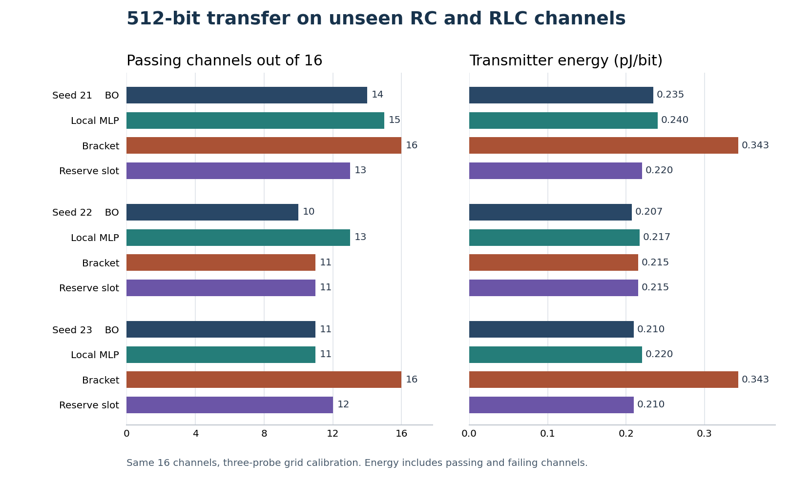

# G3 D2D 3-lane RC/RLC 최종 결과 · 2026-11-25

세 배선의 네 검증 패킷이 모두 aperture margin ≥ 0.08 V/VDD, 중심 오류 0, overshoot ≤ 0.2 VDD여야 채널 통과다. 주 표에서는 64비트 훈련 패킷 세 번에 한 위상의 세 배선 마진만 읽는 grid 정책을 고정했다. 에너지는 실패 채널까지 포함한 전송 payload의 TX pJ/bit다.

**같은 세 관측을 쓰는 BO + 포물선 보정이 에너지와 통과율의 균형이 가장 명확했다.** 세 seed에서 기존 BO의 grid 결과 35/48을 42/48로 높였고, 동일 회로라 추가 송신 에너지는 0이었다. 국소 MLP + 포물선은 43/48로 한 조합 더 통과했다. 단순 grid를 고정하면 MLP가 BO보다 +8.3%p [채널 bootstrap 95% +2.1, +14.6]였고 평균 TX 에너지는 0.008744 pJ/bit 높았다. 두 지표 모두에서 일관되게 앞선 단일 탐색법은 확인하지 못했다.

## 512비트 주 시험

채널 seed 49103, RC 8개와 RLC 8개에 같은 설계·패킷 조합을 사용했다. 각 셀은 통과 채널 수 / 16과 평균 TX 에너지다.

|탐색 seed|BO|국소 MLP|bracket|마진 여유 슬롯|
|---:|---:|---:|---:|---:|
|21|14/16 · 0.23475|15/16 · 0.24015|16/16 · 0.34301|13/16 · 0.22023|
|22|10/16 · 0.20722|13/16 · 0.21749|11/16 · 0.21535|11/16 · 0.21535|
|23|11/16 · 0.20968|11/16 · 0.22023|16/16 · 0.34301|12/16 · 0.20985|

bracket의 seed 21·23에서 반환한 벡터는 같은 초기 후보 [1.8, 7.5, 3.5, 2.2, 2.8, 3.0]이다. 높은 통과율 중 이 부분은 초기 후보를 유지한 효과다. seed 22의 여유 슬롯은 기존 bracket과 같은 회로다. 각 seed에서 같은 초기 자료와 96회 평가 예산을 썼다.

같은 192비트 관측으로 수신측 grid 선택 대신 세 점 포물선을 맞추면 BO는 seed 21·22·23에서 14·13·15개를 통과했다(합계 42/48, grid 35/48). 국소 MLP는 15·14·14개(43/48, grid 39/48)였다. 포물선과 배선별 곡선 대조의 seed별 통과 수는 이 패널에서 같았다. 제조 회로가 고정돼 TX 에너지가 동일하다.

[세 관측 보정의 채널별 득실](PHASE_EFFECT_KO.md) · [RC/RLC별 성적과 BO 대비 득실](ALL_512_KO.md) · [채널 단위 짝지은 95% 구간](ALL_PAIRED_KO.md) · [그리드·포물선·배선별 곡선·사후 위상 상한](SIZING_KO.md)

## 개발 실패에서 출발한 독립 대조

- 여유 슬롯은 49105의 12채널 × 256비트 시험에서 기존 bracket 대비 평균 통과율 −22.2%p, TX −0.085055 pJ/bit였다. BO 대비 +8.3%p, −0.002274 pJ/bit였다. 통과율 차이는 같은 탐색 seed끼리 비교해 채널별로 평균했다. [seed별 결과](RESERVE_PAIRED_KO.md) · [95% 구간](RESERVE_INTERVAL_KO.md)
- MLP는 개발 중 반환한 새 후보 30개 모두를 통과로 예측했지만, 즉시 수행한 실제 짧은 측정에서는 15개가 통과했다. 150개 앙상블 구성모형 학습 중 L-BFGS 수렴 경고가 145회 발생했다. 30개 제안 벡터를 당시 기록에서 모두 재현했다. [개발 시점 예측 검산](MLP_AUDIT_KO.md)
- 고정 bo11의 49104 보조 시험에서 무보정은 5/8, grid와 두 이차 보정법은 모두 6/8이었다. [8채널 시험](LANE_49104_KO.md)
- 기존 네 회로의 49102 독립 시험에서 무보정 27/96, grid 34/96, 포물선 36/96, 개발 사전모형 38/96, 사후 공통 위상 상한 43/96이었다. 나머지 53개는 배선별 위상까지 허용해도 마진 또는 오류 기준을 충족하지 못했다. 독립 표본은 24채널이다. [위상 비교](TEST_KO.md) · [실패 분류](TEST_LIMITS_KO.md)
- 세 번 보정한 훈련 payload의 실제 링크 TX 에너지는 BO 회로에서 112.03~118.97 pJ였다. 49106의 두 번 보정 시험에서 고정 경로와 적응 경로 모두 5/12, 79.34 pJ였다. [에너지](TEST_ENERGY_KO.md) · [두 번 관측 대조](TWO_PROBES_KO.md)
- 49102에서 기준에 가장 가까운 RC/RLC 통과·실패 사례 네 개를 UI/128로 재적분했다. 채널 및 패킷 통과 판정이 네 사례 모두 유지됐다. [해상도 검증](RESOLUTION_KO.md)

## seed 21 기하평균 사이징

긴 검증에 쓰는 두 번째 후보의 크기를 개발에서 정한 두 회로의 기하평균으로 설정했다. 새 49107의 6채널(3 RC, 3 RLC)에서 검증했다. 고정된 단일 탐색 seed의 소규모 실험이다.

|방법|grid 통과|전체 TX pJ/bit|
|---|---:|---:|
|previous_bo11|3/6|0.19808|
|bo_s21|5/6|0.23877|
|bracket_s21|6/6|0.34920|
|reserve_s21|5/6|0.22450|
|midpoint_s21|6/6|0.27802|

중간 설계는 grid에서 기준 회로와 함께 6/6을 통과하며 송신 에너지를 20.4% 줄였다. 같은 세 관측으로 포물선 보정을 쓰면 BO와 여유 슬롯도 6/6에 도달했고 전체 TX 에너지는 각각 0.23877, 0.22450 pJ/bit였다. 따라서 이 파일럿에서 중간 설계의 우위는 보정법 선택에 의존한다. [채널별 원자료 및 위상 대조](MIDPOINT_KO.md)

## 실행 비용과 검증 범위

|단계|기록으로 확인한 transient 수|
|---|---:|
|기존 설계 개발 및 민감도 진단|448 + 24|
|기존 설계 24채널 독립 시험|672|
|3개 탐색법, seed 21·22·23, seed 내부 캐시 반영|216 + 216 + 208|
|512비트 주 시험과 여유 슬롯 추가 측정|1,008 + 224|
|여유 슬롯 개발 추가분 및 256비트 독립 시험|16 + 672|
|고정 bo11 시험과 두 번 보정 시험|56 + 72|
|시간 해상도 검증|16|
|기하평균 개발 추가분 및 6채널 독립 시험|8 + 210|
|독립 재현 전 소계|4,066|
|원격 체크아웃에서 BO/MLP 동일 패킷 재측정|14|
|합계|4,080|

기본 탐색의 논리 예산은 3방법 × 3 seed × 96회 = 864회이며, 공통 초기/중복 후보를 seed 안에서 재사용해 기록상 640회가 필요했다. 여유 슬롯 및 기하평균도 각각 96회 예산에서 긴 후보 하나를 교체한 비교다. 표는 중복 캐시 적중을 제외한 완료 측정 비용으로, 중단 전에 저장되지 않은 부분 계산과 이전 3-lane 기준선 생성 비용은 제외했다. 위상 정책들은 같은 파형을 공유한다. 수신기·마진 모니터·프리앰블 전력은 제외했다.

원격 브랜치의 새 체크아웃에서 단위 테스트 8개를 통과했고, 30개 MLP 제안 및 보정 효과 표와 그림을 재현했다. BO와 MLP가 다르게 판정된 512비트 채널의 두 회로도 ngspice로 다시 실행해 판정과 에너지를 확인했다. [물리 재현 대조](COLD_RERUN_KO.md)

모든 계획된 패널과 후속 대조가 완료됐다. 독립 패널의 채널·설계 키, 동결 설계 해시, 제약과 통과 플래그 일치 여부를 검산했고, seed 49101~49107에서 실제 사용한 646개 패킷 seed ID 사이에 중복이 없었다. 테스트 패킷은 보정 정책 학습이나 회로 선택에 사용하지 않았다. 49103 확장 비교에서는 49105 시험 전에 이미 동결한 설계를 그대로 측정했다. 실물 측정과 채널 분포 외 일반화는 이 합성 ngspice 실험의 검증 범위 밖이다.

[재현 명령](README.md) · [설계 동결 및 비용](SELECTION_KO.md) · [탐색 상세 비용](COSTS_KO.md)
